# Sim Sensor

**A gas detector simulator for hazmat training.** Android phones become simulated multi-gas
meters (O₂, LEL, CO, H₂S, HCN). Instructors run the exercise from a web console: they place
virtual leaks on a map or on Bluetooth beacons at the site, watch every trainee's readings live,
and can override any reading at any moment. Trainees see realistic readings and alarms that
change as they move.

> **SIMULATOR — TRAINING ONLY.** Sim Sensor never measures anything. Never use it to detect real
> hazards.

<p align="center">
  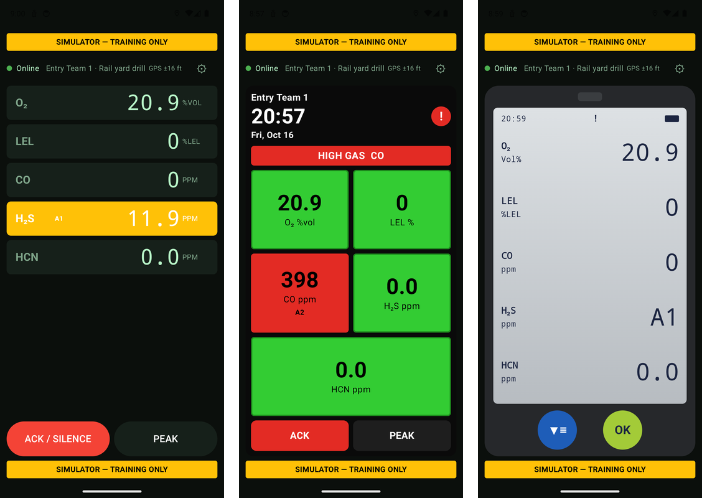
</p>

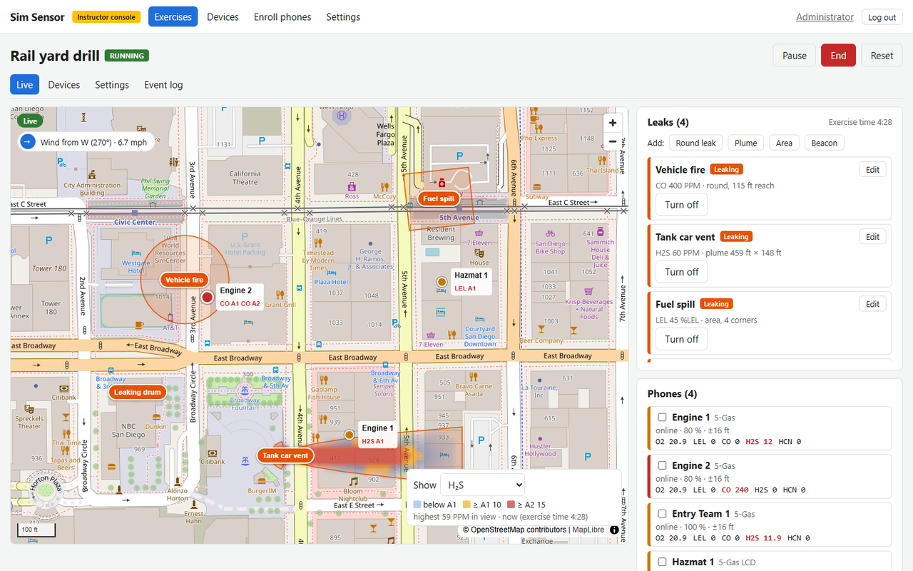

---

## Contents

- [What it does](#what-it-does)
- [How a training session works](#how-a-training-session-works)
- [The instructor console](#the-instructor-console)
- [The phone app](#the-phone-app)
- [Install on a server](#install-on-a-server)
- [First sign-in: replace the default admin account](#first-sign-in-replace-the-default-admin-account)
- [Updating the server](#updating-the-server)
- [Setting up phones](#setting-up-phones)
- [Development](#development)
- [Documentation](#documentation)

## What it does

- **Virtual leaks on a map.** Round leaks, plumes that drift downwind, and areas. Each has its own
  gases, strength, start time, growth and duration. The phone's GPS position decides what it reads.
- **Leaks on Bluetooth beacons.** For indoor or close-range work, a small beacon becomes the gas
  source. Readings rise as the phone gets closer, with no GPS needed, and a calibrated *gas edge*
  stops the reading at a doorway rather than through the wall.
- **Realistic meters.** Readings respond with a set sensor lag. A1 (low) and A2 (high) alarms come
  with tone and vibration. Latching alarms stay on until acknowledged, alongside STEL and TWA
  exposure alarms, peak readings and an O₂ drop where other gases displace it. Three screen styles
  look like the meters agencies carry.
- **Monitors per phone.** Set up each meter model the agency uses, with its sensors and alarm
  levels. Each phone imitates one of them.
- **Live control.** The instructor sees every phone on the map with its readings and alarms, and
  can set, ramp or offset a reading, fault a sensor, silence alarms or send a message to a phone.
- **Event log** of everything that happened, for the debrief.
- **Built for agency fleets.** Phones enroll with a QR code or with no taps through an MDM, and
  keep one entry on the console even when reinstalled. The server updates itself from the
  console.

## How a training session works

1. **Set up once:** the monitors your agency uses (Settings → Monitors) and any beacons
   (Settings → Beacons).
2. **Create the exercise:** name, location, phones and beacons in one dialog.
3. **Place the leaks** on the exercise's map: click a leak type, then the map.
4. **Start** the exercise. Phones in it switch from the waiting screen to the meter, and the leaks
   begin to release gas on their timings.
5. **Watch and steer** on the Live map: who is where, what they read, who acknowledged which
   alarm. Change the wind or override readings as the scenario requires.
6. **End** it. Every meter returns to clean air with its alarms cleared, and the event log is
   ready for the debrief.

## The instructor console

The console is a web app served by the Sim Sensor server. Instructors see the exercises they're
on; admins also manage accounts, email and server updates.

### Live map

Leaks, phones and their readings, live. The gas overlay shows where a gas reaches and how strong it
is, coloured by the A1 and A2 levels. The panel on the right lists the leaks (turn them on and
off, edit them) and the phones, and holds the instructor controls.


### Creating an exercise

**Create new exercise** gathers everything in one dialog:
- **Name** and default monitor.
- **Location:** type an address and press Find. The exercise's map starts there.
- **Phones:** a phone that's already in another exercise is flagged, and ticking it moves it here.
- **Beacons:** a beacon can serve several exercises at once.

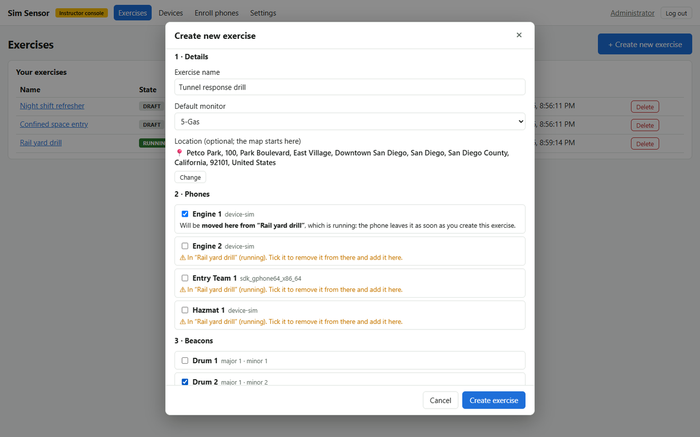

The exercises list shows each exercise's state and location. Deleting one asks for confirmation
first, and a running exercise is ended before it's deleted.

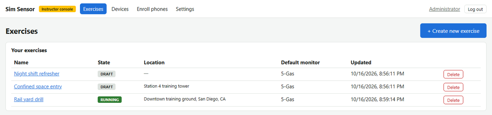

### Phones and beacons in an exercise

The exercise's **Devices** tab: the phones in it, the monitor each one imitates, and the beacons
its leaks can use.

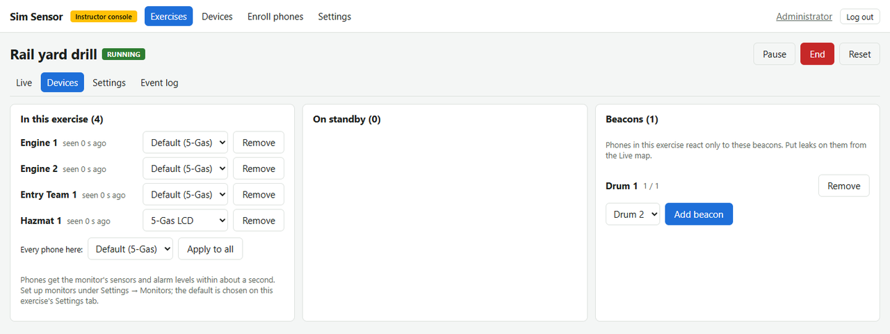

### Monitors

A monitor is a meter model: its sensors, ranges, A1/A2 levels (latching or not), STEL/TWA,
response time and screen style. Phones receive changes within about a second.

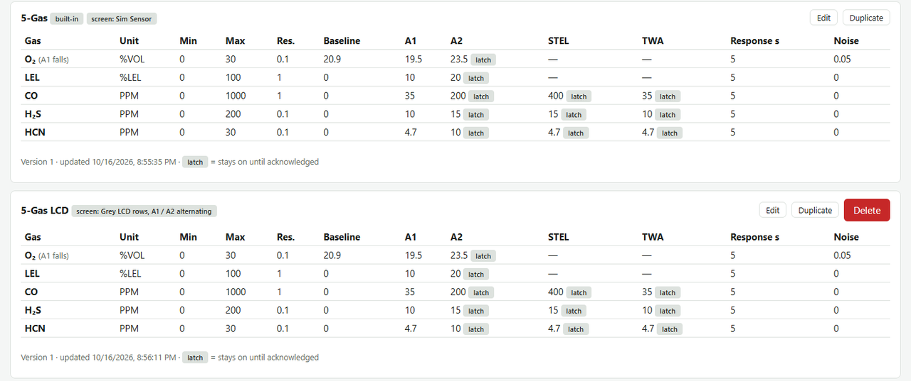

### Beacons

The agency's beacons with their identity and calibration. Calibration, including the gas edge, is
done on a phone at the site; see [docs/BEACON_SETUP.md](docs/BEACON_SETUP.md).

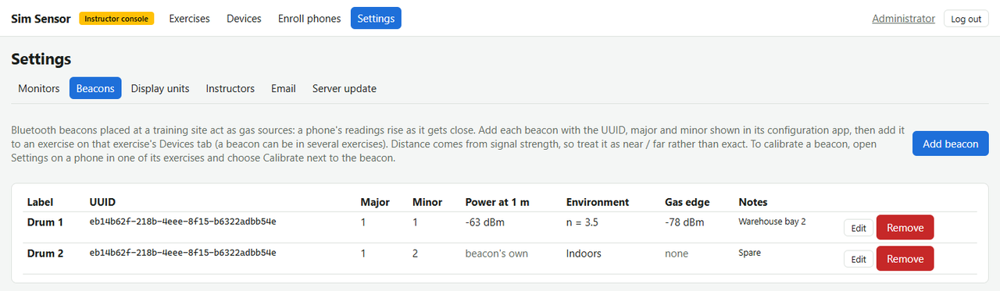

### Event log

Phones connecting, alarms raised and acknowledged, overrides, leak changes: everything, with who
did it.

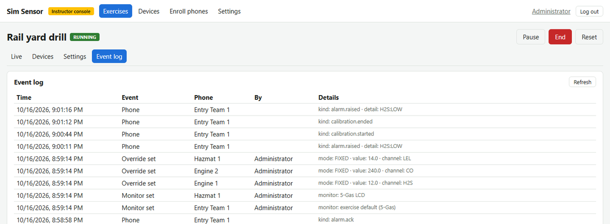

### Enrolling phones

A QR code enrolls one phone. An MDM fleet token enrolls a whole fleet with no taps, and can be
given a retirement date for rotation.

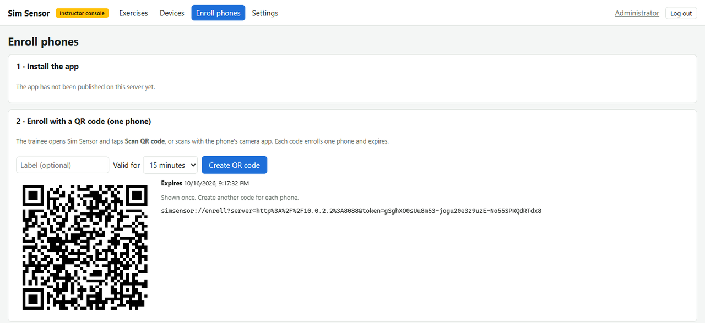

## The phone app

The app runs on any Android 8+ phone. A yellow **SIMULATOR — TRAINING ONLY** banner is always
on screen.

| Waiting for an exercise | Standard meter | Colour tiles | Grey LCD |
|---|---|---|---|
| 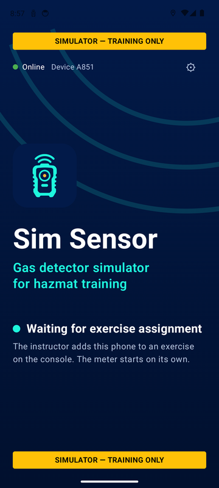 | 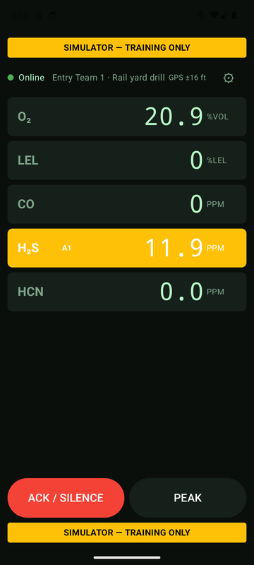 | 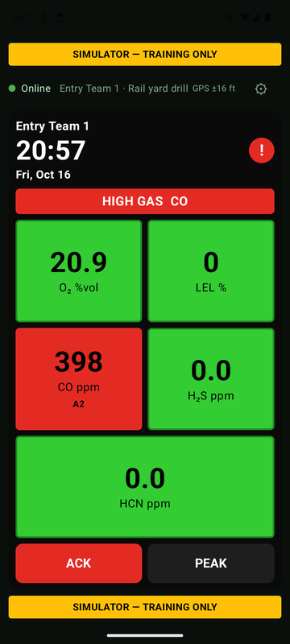 | 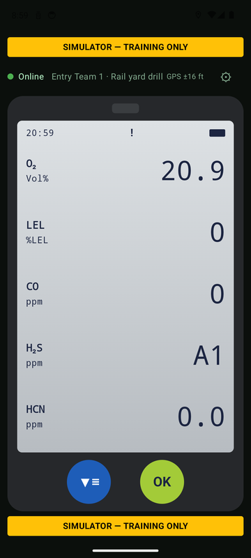 |
| Until an instructor adds the phone to an exercise. | Large readings; the alarm row turns yellow (A1) or red (A2). | Tiles turn yellow or red, with the highest alarm across the top. | A1/A2 alternate with the reading, as on the real thing. |

- **Alarms** beep and vibrate, also with the screen off or the app in the background.
  **ACK / SILENCE** acknowledges latching alarms; a new alarm always sounds again.
- **Settings** (behind an optional MDM PIN) shows the connection, exercise, monitor, GPS and
  beacons. It also has **Calibrate** for each beacon and **Shut down Sim Sensor**.
- **Calibrate** records the beacon's signal at known distances and at the gas edge. Readings and
  alarms pause while it's open.

| Settings | Calibrating a beacon |
|---|---|
| 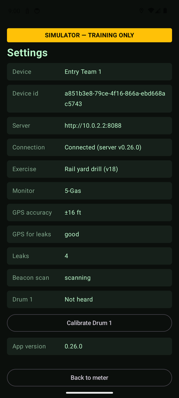 | 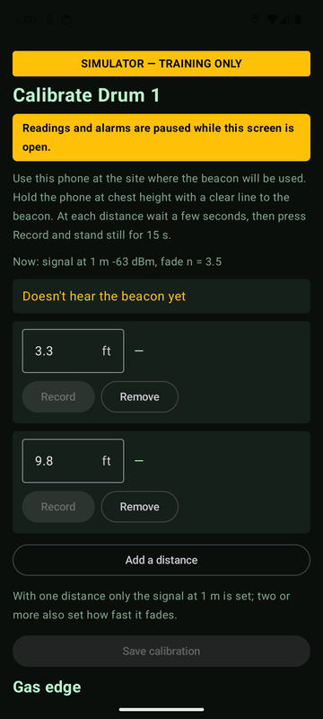 |

<sub>Screenshots from the Android emulator and a demo exercise. The emulator has no Bluetooth,
hence "Not heard".</sub>

## Install on a server

You need a Linux server with Docker (including Compose), a DNS name pointing at it, and ports 80
and 443 open. Install into `/opt/simsensor` in this layout, so that later updates can be done from
the console:

```bash
sudo -i
TAG=v0.26.0                      # the newest version tag on GitHub
mkdir -p /opt/simsensor/releases/$TAG && cd /opt/simsensor
curl -fsSL https://codeload.github.com/cfd2474/sim_sensor/tar.gz/refs/tags/$TAG \
  | tar -xz --strip-components=1 -C releases/$TAG
ln -sfn /opt/simsensor/releases/$TAG current
cp current/deploy/.env.example .env   # set SIM_DOMAIN to your DNS name and a strong POSTGRES_PASSWORD
cd current/deploy && docker compose --env-file /opt/simsensor/.env up -d --build
```

The first build takes several minutes. Caddy gets an HTTPS certificate for `SIM_DOMAIN` by itself.
Then open `https://<your DNS name>` and sign in for the first time (next section).

Optional settings in `/opt/simsensor/.env` are explained in
[deploy/.env.example](deploy/.env.example). They cover the first admin account, the address
search service and the update repository.

## First sign-in: replace the default admin account

A fresh install, one with no accounts yet, starts with one **default admin account**:

| | |
|---|---|
| Email | `admin@simsensor.local` |
| Password | `SimSensor-Admin1` |

> ⚠️ **This password is public: it is printed here.** Anyone who can reach your server can sign
> in with it until you deactivate the account. Do the steps below **straight after installing**.
> Until then, the console shows an orange warning on every page.

1. Sign in with the default account above.
2. Go to **Settings → Instructors** and **add an admin account with your own email address and
   your own password** (at least 8 characters). Choose the role **Admin**.
3. **Log out**, then **sign in with your new account**.
4. In **Settings → Instructors**, find `admin@simsensor.local` and **deactivate** it.
   (An account can't deactivate itself, which is why you sign in as yourself first.)

When the orange warning disappears, the default account can no longer be used.

The default account is created only when the database has no accounts at all. Existing installs
and upgrades are never affected. To skip it, set `SIM_ADMIN_EMAIL` and `SIM_ADMIN_PASSWORD` in
`/opt/simsensor/.env` before the first start; that account is then created instead.

Next, under **Settings → Email**, connect an SMTP provider (presets for Brevo and Resend) to turn
on "Forgot password?" and email invitations for instructors.

## Updating the server

**Settings → Server update** (admins) shows the running version, the newest one on GitHub and
what's new, with an **Update** button. The update:
1. backs up the database;
2. downloads and builds the new version;
3. restarts the server (about a minute offline; phones reconnect by themselves);
4. goes back to the previous version by itself if the new one doesn't start.

This is done by the stack's `updater` service, the only part with access to Docker. It has no
network port and only acts on requests from the server. It doesn't update itself: if a release's
notes mention a change to the updater, rerun the last install command above (`docker compose …
up -d --build`) in `/opt/simsensor/current/deploy`.

## Setting up phones

1. **Install the app** on the phones: through your MDM, from the download on the console's
   **Enroll phones** page when the server has one published, or from Google Play once it's
   released there (in closed testing now). All are the same app and update each other.
2. **Enroll** each phone, with either:
   - **a QR code** from the Enroll page: the trainee taps **Scan QR code** in the app, or scans
     it with the phone's camera;
   - **no taps, through an MDM**: push these managed-configuration keys to
     `com.taksolutions.simsensor`.

     | Key | Value |
     |---|---|
     | `server_url` | `https://<your DNS name>` |
     | `enrollment_token` | a fleet token from the Enroll page |
     | `device_name` | optional: the name shown on the console |
     | `settings_pin` | optional: a PIN for the phone's Settings screen |

     A phone that loses its enrollment enrolls again by itself while the token is valid, and
     keeps its entry on the Devices list.
3. **Grant permissions** (or pre-grant them through the MDM): location (for map leaks),
   notifications (for alarms in the background) and Nearby devices (for beacon leaks).

For beacon leaks, see [docs/BEACON_SETUP.md](docs/BEACON_SETUP.md): programming the beacon,
placing and shielding it, and calibrating it on a phone.

## Development

| Path | What |
|---|---|
| `android/` | Android app (Kotlin, Jetpack Compose) |
| `shared/` | Kotlin Multiplatform: protocol and the gas and sensor model (JVM + JS) |
| `server/` | Ktor server (PostgreSQL/TimescaleDB, Redis); also serves the console |
| `console/` | Instructor web console (React, TypeScript, Vite, MapLibre) |
| `deploy/` | Docker Compose stack (Caddy, server, database, Redis, updater) |
| `tools/` | Release and asset scripts (signed APK and Play bundle, icons, store graphics) |
| `docs/` | Design, protocol, API, platform reference, release notes, guides |

Requirements: JDK 17, the Android SDK (path in `local.properties` as `sdk.dir=...`), Node 22+ and
Docker (the server tests start a database container).

```bash
./gradlew check                      # all tests and release checks
./gradlew :android:assembleDebug     # APK in android/build/outputs/apk/debug/
./gradlew :server:run                # server on http://localhost:8080
cd console && npm ci && npm run dev  # console on http://localhost:5173, proxied to :8080
```

Server-only builds (no Android SDK): set `SIMSENSOR_SKIP_ANDROID=1`.

To run the whole stack locally:

```bash
cd deploy
cp .env.example .env    # set SIM_DOMAIN=localhost and a POSTGRES_PASSWORD
docker compose up -d --build
# https://localhost  (Caddy's local certificate; accept it in the browser)
```

`VERSION` is the product version. Every product-changing push bumps it, tags the commit `vX.Y.Z`,
and adds a section to [docs/RELEASE_NOTES.md](docs/RELEASE_NOTES.md); see `CLAUDE.md` §9.

## Documentation

| Document | What's in it |
|---|---|
| [docs/RELEASE_NOTES.md](docs/RELEASE_NOTES.md) | What changed in each version |
| [docs/BEACON_SETUP.md](docs/BEACON_SETUP.md) | Setting up beacon leaks for instructors |
| [docs/DESIGN.md](docs/DESIGN.md) | How it's built and why |
| [docs/PROTOCOL.md](docs/PROTOCOL.md) | Phone ↔ server and console ↔ server messages |
| [docs/openapi.yaml](docs/openapi.yaml) | The console's HTTP API |
| [docs/ANDROID_PLATFORM_REFERENCE.md](docs/ANDROID_PLATFORM_REFERENCE.md) | The Android behaviour the app relies on, with sources and what was verified on hardware |
| [docs/PLAY_RELEASE.md](docs/PLAY_RELEASE.md) | Google Play listing and release routine |
| [PROJECT_STATE.md](PROJECT_STATE.md) | Where the work stands, decisions and their reasons |
