# Sim Sensor user manual

For agency administrators and instructors who install Sim Sensor, set up its phones and beacons,
and run training exercises with it. It describes Sim Sensor v0.35.0 and later.

A printable copy with the same pictures: [USER_MANUAL.pdf](USER_MANUAL.pdf).

> **SIMULATOR — TRAINING ONLY.** Sim Sensor never measures gas. Every reading is simulated. Never
> use it to detect real hazards.

## Contents

1. [What Sim Sensor is](#1-what-sim-sensor-is)
2. [Install the server](#2-install-the-server)
3. [First sign-in, accounts and email](#3-first-sign-in-accounts-and-email)
4. [Set up the phones](#4-set-up-the-phones)
5. [Set up the sensors: monitors](#5-set-up-the-sensors-monitors)
6. [Set up beacons](#6-set-up-beacons)
7. [Build an exercise](#7-build-an-exercise)
8. [Run an exercise](#8-run-an-exercise)
9. [The phone app, as the trainee sees it](#9-the-phone-app-as-the-trainee-sees-it)
10. [Debrief: the event log](#10-debrief-the-event-log)
11. [Manage the system](#11-manage-the-system)
12. [Troubleshooting](#12-troubleshooting)
13. [Glossary](#13-glossary)

---

## 1. What Sim Sensor is

Sim Sensor turns Android phones into simulated multi-gas meters for hazmat, confined-space and fire
training. It has three parts:

| Part | Who uses it | What it does |
|---|---|---|
| **Server** | Your IT or the administrator, once | Runs on a Linux machine with a DNS name. Holds the exercises, accounts and phones, and serves the console. |
| **Instructor console** | Administrators and instructors | A website (`https://<your server>`): set up monitors, beacons and exercises, then watch and control them live. |
| **Phone app** | Trainees | Shows a meter that reads the simulated gas where the phone is, with alarms, as a real meter would. |

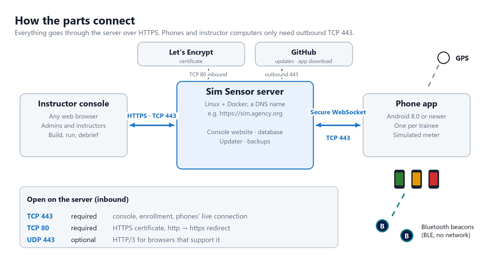
*The parts and the ports between them. Phones and instructor computers need only outbound TCP 443.*

**How readings work.** An instructor places virtual leaks: on the map (the phone's GPS position
decides what it reads) or on small Bluetooth beacons at the training site (the phone's distance
from the beacon decides). Each phone imitates a **monitor**: a meter model the agency owns, with
its sensors, alarm levels and screen style. Instructors can also override any reading at any time.

**Roles in the console.**

| Role | Can |
|---|---|
| **Admin** | Everything: accounts, email, display units, server updates and backups, monitors, beacons, enrollment, and every exercise. |
| **Instructor** | Create exercises and run the ones they're listed on (an exercise's **Settings** tab lists its instructors); see monitors, beacons and phones. |

**A training session, in short.**

1. Once: install the server ([§2](#2-install-the-server)), set up accounts and email
   ([§3](#3-first-sign-in-accounts-and-email)), enroll the phones ([§4](#4-set-up-the-phones)),
   define your monitors ([§5](#5-set-up-the-sensors-monitors)) and any beacons ([§6](#6-set-up-beacons)).
2. Per drill: create the exercise, place its leaks, check them on the map ([§7](#7-build-an-exercise)).
3. Start it, watch and steer ([§8](#8-run-an-exercise)), end it, and debrief from the event log
   ([§10](#10-debrief-the-event-log)).

---

## 2. Install the server

### 2.1 What you need

- **A Linux machine** that runs Docker (Ubuntu or Debian, for example), 64-bit. Suggested minimum:
  2 vCPU, 4 GB RAM and 20 GB of free disk. It's tested on 4 vCPU and 15 GB RAM; the server is built
  on the machine during installs and updates, which needs the most memory.
- **A public IP address and a DNS name** pointing at it: an A (or AAAA) record such as
  `sim.agency.org`. Create the record before installing.
- **`root` or `sudo`** on the machine.
- **Open ports**, inbound to the server:

  | Port | Protocol | Required | Why |
  |---|---|---|---|
  | 443 | TCP | Yes | The console, phone enrollment and the phones' live connection (HTTPS and secure WebSockets). |
  | 80 | TCP | Yes | Getting and renewing the HTTPS certificate, and redirecting `http://` to `https://`. |
  | 443 | UDP | No | HTTP/3 for browsers that support it. |

  Phones and instructor computers need only **outbound TCP 443** to the server. If your firewall
  limits what the server may reach, the README's
  [System requirements](../README.md#firewall-ports-and-protocols) lists every outbound address
  (certificates, updates, builds, address search, email).

### 2.2 Run the installer

On the server:

```bash
curl -fsSL https://raw.githubusercontent.com/cfd2474/sim_sensor/main/deploy/install.sh -o install.sh
sudo bash install.sh
```

The installer guides you:

1. It checks for Docker and offers to install it if it's missing.
2. It asks for the **domain name** (for example `sim.agency.org`: no `https://`, no port) and
   checks that the name points at this server.
3. It asks for an **email address for the HTTPS certificate**.
4. It installs the newest version into `/opt/simsensor` and writes all the settings itself,
   including a random database password. **There's no settings file to edit.**
5. It starts everything and waits until `https://<your name>` answers with a valid certificate,
   then prints the first sign-in steps.

The first build takes several minutes. When it's done, open `https://<your name>` in a browser.

<p align="center">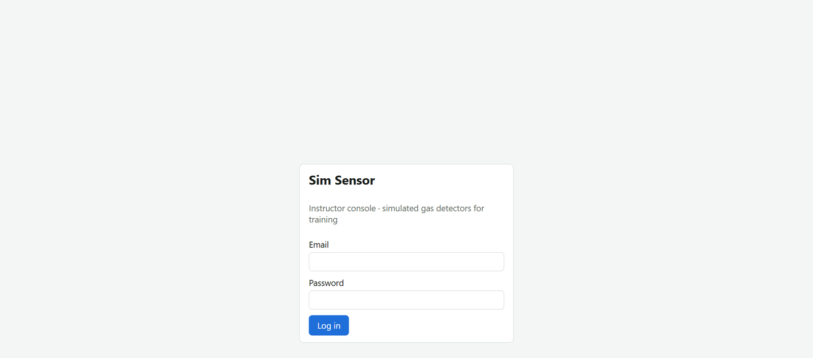</p>

*The console sign-in page.*

**Changing the domain name or the certificate email later:**

```bash
sudo bash /opt/simsensor/current/deploy/install.sh --reconfigure
```

### 2.3 The HTTPS certificate

The certificate comes from Let's Encrypt and renews itself; there's nothing to do. Sim Sensor also
checks its own certificate every day: if renewal starts failing (for example port 80 is closed or
the DNS name moved), admins see a warning on every console page, and get an email once a day if
email is set up. **Settings → Server update** shows when the certificate expires.

---

## 3. First sign-in, accounts and email

### 3.1 Replace the default admin account (do this first)

A new server starts with one account whose password is public:

| Email | Password |
|---|---|
| `admin@simsensor.local` | `SimSensor-Admin1` |

Until you replace it, the console shows an orange warning on every page.

1. Sign in with that account.
2. **Settings → Instructors**: add an account with **your own email** and a password of at least
   8 characters, role **Admin**.
3. **Log out**, and sign in with your new account.
4. **Settings → Instructors**: **deactivate** `admin@simsensor.local`.

### 3.2 Set up email (recommended)

Without email, nobody can reset a forgotten password on their own. **Settings → Email** (admins):

1. Choose a preset or enter your provider's SMTP server:

   | Provider | Server | Port and security | User name | Password |
   |---|---|---|---|---|
   | Brevo | `smtp-relay.brevo.com` | 587, STARTTLS | your SMTP login | an SMTP key |
   | Resend | `smtp.resend.com` | 465, SSL | `resend` | an API key |

2. Enter the **sender address** and name. The provider must have verified that address (usually by
   verifying your domain), or it refuses the mail.
3. **Send test email**. It goes to your own address; a failure shows the provider's exact error.

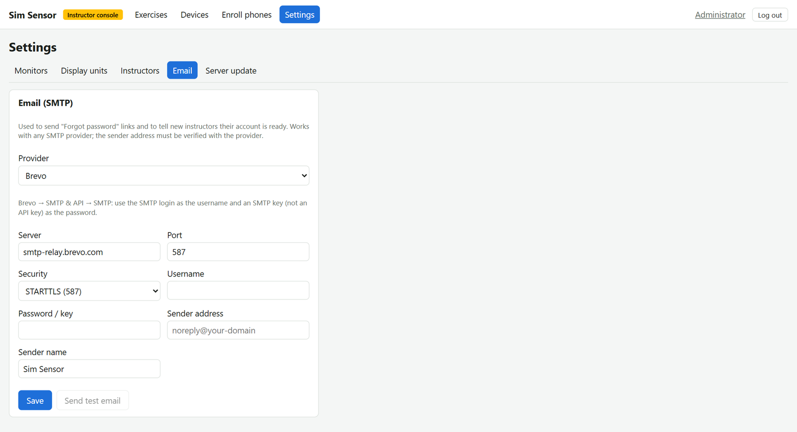
*Settings → Email.*

With email set up you get **Forgot password?** on the sign-in page (a one-hour, single-use link),
invitations for new instructors, **Email reset link** for admins, and certificate warnings by
email. The SMTP password is never shown again after saving.

### 3.3 Instructor accounts

**Settings → Instructors** (admins):

- **Add** an account: name, email and role (**Instructor** or **Admin**). Tick **Email them a link
  to set their password** to let them choose their own (the link lasts 72 hours); without email,
  set a password for them.
- **Reset password** or **Email reset link** for someone who's locked out.
- **Deactivate** an account to stop it signing in. An account can't deactivate itself.

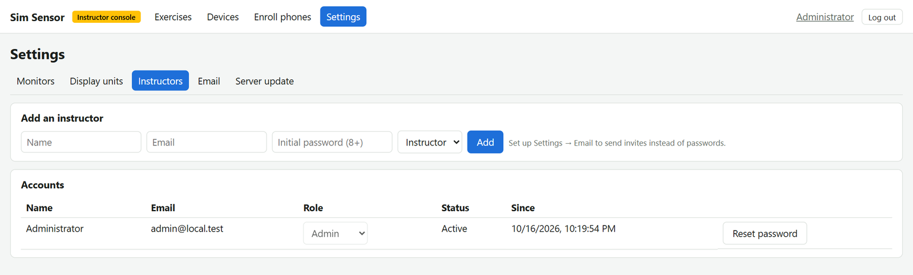
*Settings → Instructors: add accounts, reset passwords, deactivate.*

Each person can change their own password on their account page (their name at the top right of
the console).

### 3.4 Display units

**Settings → Display units** (admins): **Imperial (feet, mph)** or **Metric (metres, m/s)**. It
applies to the whole console and to every phone (distances, GPS accuracy, wind speed).

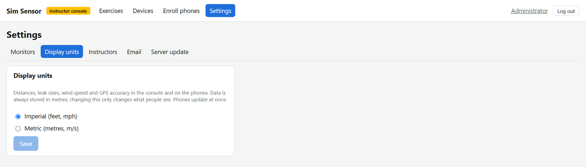
*Settings → Display units.*

---

## 4. Set up the phones

### 4.1 Install the app

The app runs on **Android 8.0 or newer**. It's the same app however you install it, signed with
the same key, so the copies update each other:

- **From the console:** **Enroll phones** shows a QR code that downloads the app from your server.
  Scan it with the phone's camera.
- **From GitHub:** the APK on the [latest release](https://github.com/cfd2474/sim_sensor/releases/latest),
  with its checksum and signing certificate.
- **Through your MDM:** upload that APK to the MDM and push it.

The server keeps its own download on the app that goes with its version, by itself.

### 4.2 Permissions

Grant these when the app asks (or pre-grant them through the MDM):

| Permission | Needed for |
|---|---|
| **Location** (precise) | Leaks on the map: the phone's position decides what it reads. |
| **Notifications** | Alarms while the app is in the background or the screen is off. |
| **Nearby devices** | Beacon leaks (Bluetooth). |
| **Camera** (optional) | Scanning the enrollment QR code in the app. |

### 4.3 Enroll a phone

Enrolling connects a phone to your server. Each phone keeps **one entry** in the console, even if
the app is reinstalled.

Creating enrollment codes and tokens is for admins.

**One phone at a time, with a QR code.** **Enroll phones** → choose how long the code stays valid
(**15 minutes**, **1 hour**, **8 hours** or **24 hours**) → **Create QR code**. On the phone, open
Sim Sensor and tap **Scan QR code**, or scan it with the phone's own camera. Each code is shown
once and enrolls one phone; create another for the next.

**A whole fleet with no taps, through an MDM.** **Enroll phones** → **Create fleet token** (give it
a label, and optionally a **Retire on** date). Push these managed-configuration keys to the app
`com.taksolutions.simsensor`:

| Key | Value |
|---|---|
| `server_url` | `https://<your server name>` |
| `enrollment_token` | the fleet token |
| `device_name` | optional: the name shown in the console |
| `settings_pin` | optional: a PIN that protects the phone's Settings screen and shutting it down |

Phones enroll as soon as they get the configuration. A phone that loses its enrollment enrolls
again by itself while the token is valid. **Retiring a token:** set a retire date, or **Retire
now**; phones already enrolled keep working.

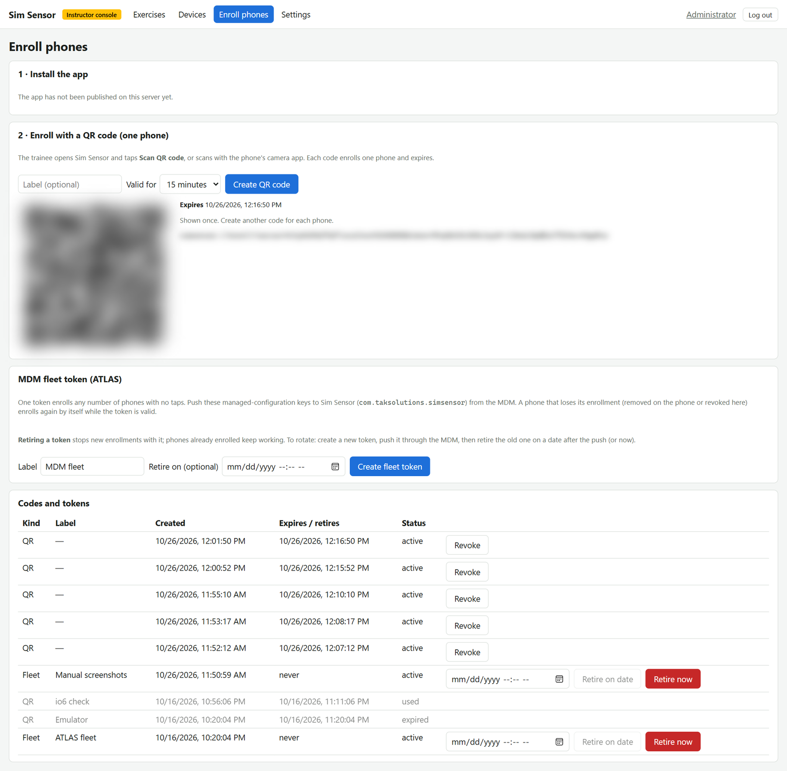
*Enroll phones: a single-use QR code (blurred here), the MDM fleet tokens and the codes created so far.*

### 4.4 The phone list

**Devices → Phones** lists every enrolled phone: its name (click to rename), its exercise, its
group, when it was last seen, and its model and app version.

- **Groups** (bottom of the page, admins) let you aim instructor controls at several phones at
  once, for example "Entry team". Create a group, then pick it for each phone.
- **Revoke** (admins) removes a phone: it disconnects at once and can't reconnect until enrolled
  again. **Show revoked** lists removed phones.

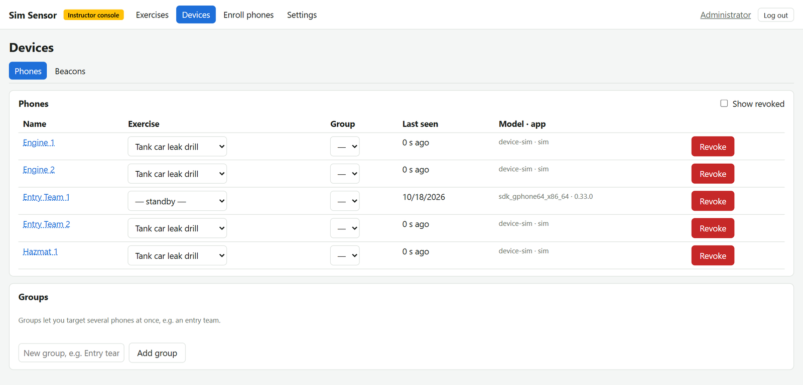
*Devices → Phones: every enrolled phone, its exercise, group, last contact and app version.*

A phone not in any exercise shows a **waiting screen** until an instructor adds it to one.

<p align="center">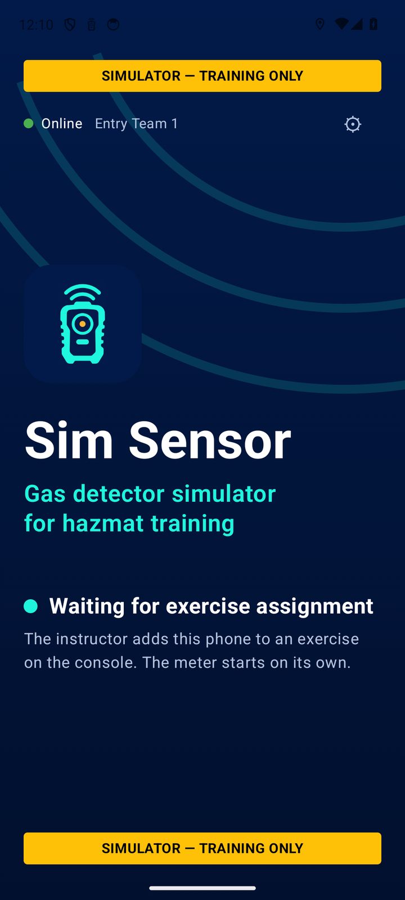</p>

*The waiting screen: enrolled, online, not in an exercise yet.*

---

## 5. Set up the sensors: monitors

A **monitor** is a meter model as your agency has it configured: which sensors it has, their
ranges and alarm levels, how fast they respond, and which screen style the phone shows. Every
phone in an exercise imitates one monitor. Set them up once under **Settings → Monitors**
(everyone can see them; admins edit). A **5-Gas** monitor (O₂, LEL, CO, H₂S, HCN) is built in.

### 5.1 Create or edit a monitor

**New monitor** (or **Edit** / **Duplicate** on an existing one):

- **Name** (as instructors will see it) and **Make and model** (free text, for example "Dräger
  X-am 2800").
- **Phone screen:**

  | Choice | Looks like |
  |---|---|
  | Sim Sensor (generic) | Large rows, coloured yellow (A1) or red (A2) |
  | Tiles, green / yellow / red | A Blackline G8 |
  | Grey LCD rows, A1 / A2 alternating | A Dräger X-am |
  | Grey LCD, 2 × 3 gas cells under a status bar | An MSA ALTAIR io 6 (up to six gases) |

  
  *The phone screen styles: generic, tiles, grey LCD rows, and the 2 × 3 LCD.*

- **Sensors:** **Add sensor** and pick one per row. Available sensors: O₂, LEL, CO, H₂S, HCN,
  NH₃, SO₂, Cl₂, HF, CO₂ and **VOC (PID, isobutylene)**. Each starts with sensible defaults you can
  change:

  | Column | Meaning |
  |---|---|
  | **Min / Max** | The sensor's range. Above Max the meter reads **OL** (over limit). O₂ is fixed at 0–25 %. |
  | **Res.** | Resolution: the step the reading moves in (0.1, 1…). |
  | **Baseline** | The clean-air reading (O₂ 20.9; others 0). |
  | **A1 / A2** | Low and high alarm levels, each with a **latch** tick: a latching alarm stays on until acknowledged. For O₂, A1 is a drop below its level (**A1 ↓**) and A2 a rise above. Leave blank for no alarm. |
  | **STEL / TWA** | Short-term (15 min) and time-weighted (8 h) exposure alarms, with their own latch ticks. |
  | **Response s** | How quickly the sensor follows a change (time to show 90 % of it). |
  | **Noise** | A small random jitter, for realism. |

- **Save.** Phones using the monitor pick up changes within about a second, even mid-exercise.

A monitor in use by an exercise can't be deleted.

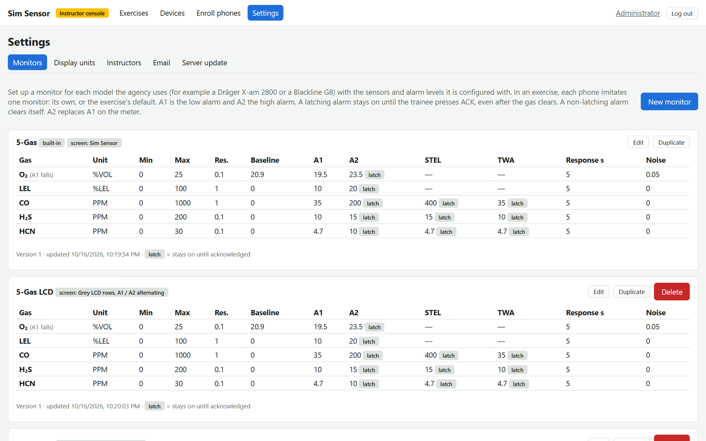
*Settings → Monitors: each monitor's sensors, ranges and alarm levels.*

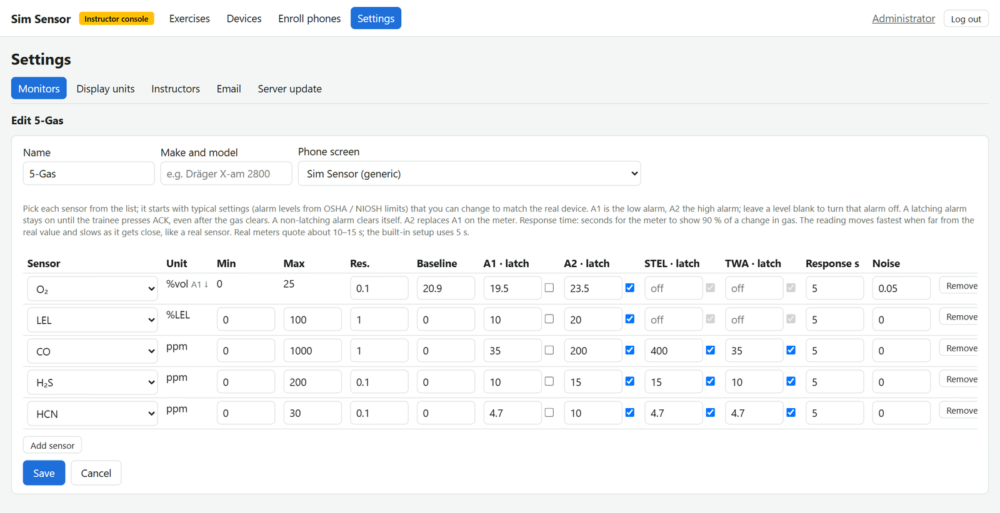
*Editing a monitor: one row per sensor.*

### 5.2 Which monitor a phone uses

1. The exercise's **default monitor** (chosen when creating it, and changeable on its **Live**
   page or **Settings** tab) applies to every phone added to the exercise.
2. On the exercise's **Devices** tab you can give a phone **its own** monitor; it keeps it until
   you change it there. **Every phone here: … Apply to all** sets all of them at once.

<p align="center">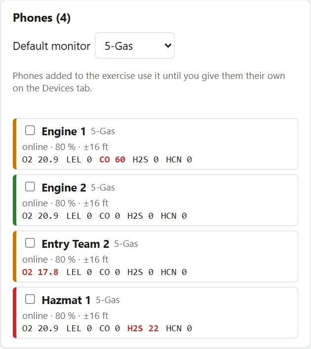</p>

*The default monitor, above the phones on the Live page.*

---

## 6. Set up beacons

Beacons are small Bluetooth tags placed at the site; a phone's reading rises as it gets closer.
Use them indoors and at close range, where GPS isn't precise enough. The full walk-through is in
the [beacon setup guide](BEACON_SETUP.md); in short:

### 6.1 Buy and program them

Tested and confirmed working: the **Feasycom FSC-BP108B** and the **PDDAXLQUE DX-CP33** (links in
the [beacon guide](BEACON_SETUP.md#the-beacon)). Other iBeacons should work, but haven't been
tested. In the beacon's own configuration app, set:

- **iBeacon on**, with your agency's **UUID**, a **major** (for example the kit) and a **minor**
  (the beacon's number); other broadcast slots off;
- **interval 200 ms**;
- a **PIN** other than the default;
- **transmit power** lower for indoor rooms, so the signal fades quickly past the walls.

### 6.2 Add them to the console

**Devices → Beacons → Add beacon** (admins): a label (for example "Drum 1"), the UUID, major and
minor. The table shows each beacon's calibration: **Power at 1 m**, **Environment**, **Gas edge**.

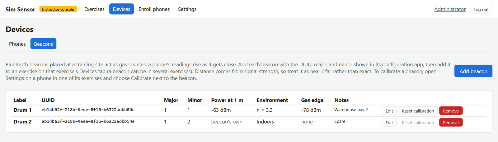
*Devices → Beacons: each beacon's IDs and calibration, with Edit, Reset calibration and Remove.*

### 6.3 Place them

Low, where the gas would collect; one beacon per room; a metal plate or foil behind a beacon keeps
its signal from reaching through that wall. Concrete and metal walls stop much more signal than
drywall.

### 6.4 Calibrate them on site

Calibration teaches the phones how strong the beacon's signal is at known distances in that room,
and where the gas should stop. It's stored on the beacon and used by every phone.

1. Add the beacon to an exercise ([§7.2](#72-phones-and-beacons)) and put a phone in it.
2. On the phone: **Settings → Calibrate <beacon>**. Readings and alarms pause while this screen is
   open.
3. **Distances:** stand 1 m from the beacon, phone at chest height, clear line of sight, and
   **Record**; then 3 m (and 5 m if there's room). **Save calibration.**
4. **Gas edge:** stand at the furthest point where the gas should still read, usually inside the
   doorway, **Record edge**, then **Save gas edge**. Weaker signal (for example through a wall)
   then reads nothing.
5. **Check:** walk outside the room and along the walls; the Calibrate screen should say **Here:
   OUTSIDE**. If a spot outside still reads inside, lower the transmit power or shield that side,
   and calibrate again.

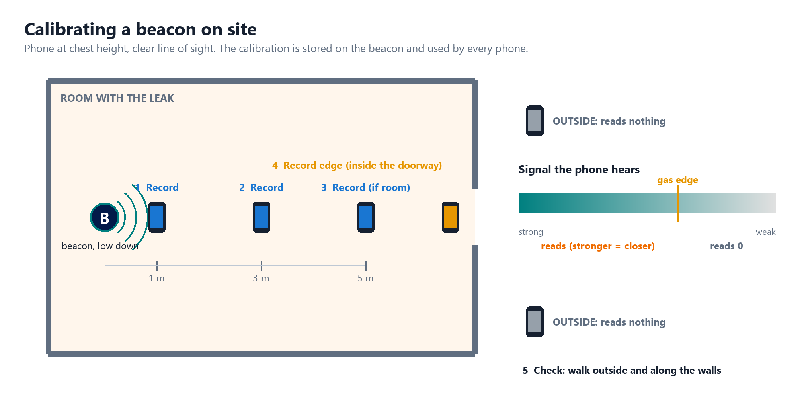
*Where to stand: 1 m, 3 m (and 5 m), the gas edge inside the doorway, then check outside.*

<p align="center"></p>

*The phone's Calibrate screen.*

Moving a beacon to another room means calibrating again. To start over, an admin can press **Reset
calibration** next to the beacon in **Devices → Beacons** (power back to the beacon's own, the
default environment, no gas edge).

---

## 7. Build an exercise

### 7.1 Create it

**Exercises → + Create new exercise** opens one dialog:

1. **Exercise name**, and the **Default monitor** for its phones.
2. **Location:** type an address and press **Find**, then pick the place. The exercise's map
   starts there.
3. **Phones:** tick the phones that take part. A phone already in another exercise is flagged;
   ticking it moves it here.
4. **Beacons:** tick any beacons its leaks will use. A beacon can serve several exercises.
5. **Create exercise.** The exercise opens on its **Live** page, in the **Draft** state: phones show
   "EXERCISE NOT STARTED" and read clean air.

<p align="center">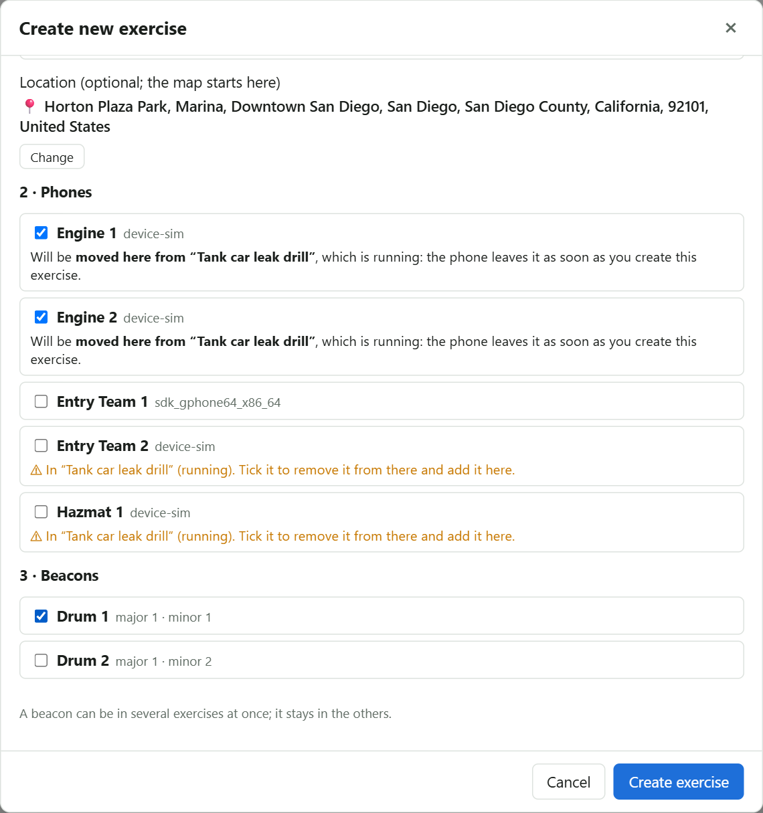</p>

*Create new exercise: name, monitor, location, phones and beacons in one dialog.*

The **Exercises** list shows each exercise's state, location and default monitor, with **Delete**
(a running exercise is ended first).

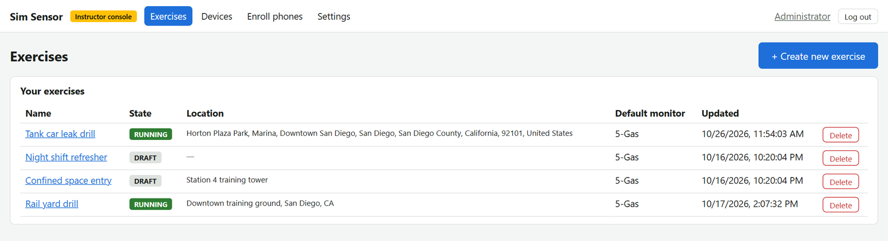
*The Exercises list.*

### 7.2 Phones and beacons

The exercise's **Devices** tab:

- **Phones in this exercise**, each with its monitor (**Default (…)** or its own) and **Remove**.
  **Add** or **Add all** phones from standby.
- **Beacons:** **Add beacon** from the inventory. Phones in the exercise listen only to its
  beacons.

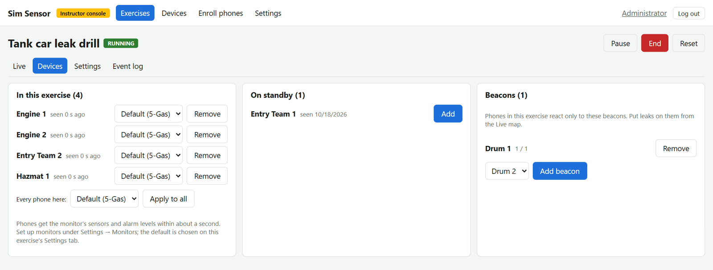
*The exercise's Devices tab: its phones (each with its monitor), phones on standby, and its beacons.*

### 7.3 Exercise settings

The **Settings** tab:

| Setting | What it does |
|---|---|
| **Name** | As shown everywhere. |
| **Default monitor (phones without their own)** | Same as on the Live page. |
| **Wind from** | Direction the wind comes from (0 = north), and its speed. Plumes drift downwind. Also changeable on the Live map. |
| **Location** | Where the Live map starts. |
| **Other gases lower O₂ (displacement)** | Off by default. When on, every measured gas lowers O₂ as it would in real air (1 % of any gas, 10,000 ppm, lowers O₂ by about 0.21). |
| **Instructors** | Who sees and controls this exercise (admins see all). |
| **Delete exercise** | Asks for confirmation. |

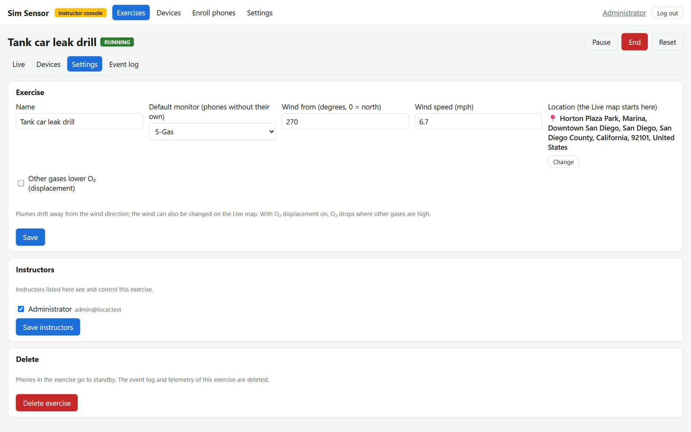
*The exercise's Settings tab.*

### 7.4 Place the leaks

On the **Live** page, under **Leaks**, pick a kind after **Add:**, then click the map:

| Kind | Placing it | Size |
|---|---|---|
| **Round leak** | Click its centre. | **Reaches**: the radius. |
| **Plume** | Click its source. It drifts downwind. | **Length** and **Width**; optionally its **own wind direction**. |
| **Area** | Click the corners, then **Finish**. | The area, plus how far the gas **spreads** past its edge. |
| **Beacon** | Pick the beacon; click where it is (the pin only marks it on the map). | **Reaches** from the beacon. Indoors, phones can't tell distances apart beyond about 5 m (16 ft), so keep the reach small or use more beacons. |

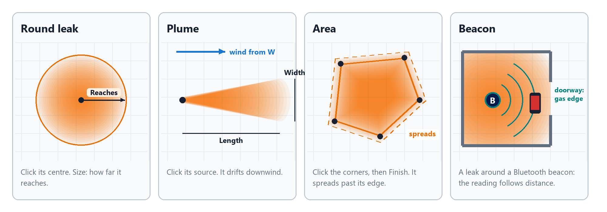
*The four kinds of leak. Darker means stronger.*

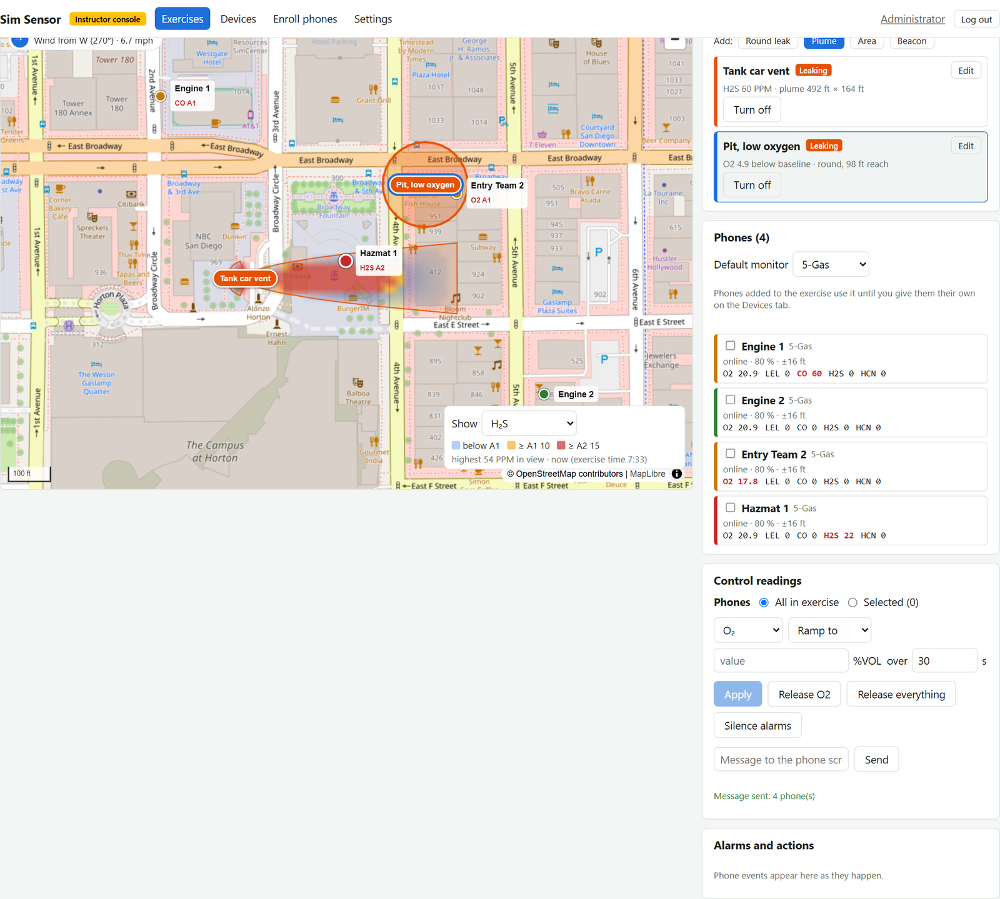
*Placing a plume: after choosing the kind, click the map where it starts.*

The leak form then asks for:

**Gases at the source.** One row per gas, with its strength at the source (for example CO 400
ppm). **+ add a gas** for more. Two special cases:

- **O₂:** choose **below baseline (depletion)** or **above baseline (enrichment)** and the amount.
  Depletion can go down to 0; enrichment is at most +5, also where leaks overlap. A new O₂ leak
  starts at 4.9 below baseline (16 %).
- **Inert gas (N₂, Ar, He…):** the share of the air it replaces (up to 100 %vol). No meter shows
  it, but O₂ falls in proportion: 20 % inert gas → O₂ 16.7 %.

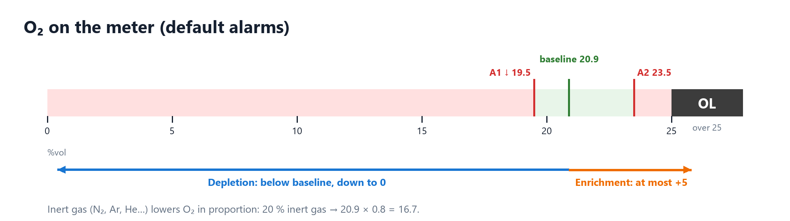
*O₂ on the meter: depletion down to 0, enrichment at most +5, and OL above the 0–25 range.*

<p align="center">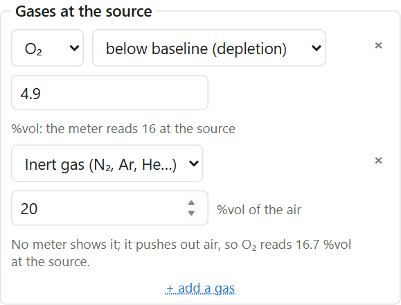</p>

*O₂ 4.9 below baseline plus 20 % inert gas: the form shows what the meter reads at the source.*

Under each, the form shows what the meter will read at the source.

**Strength falls off** from the source to the edge: **smoothly (default)**, **evenly**, or
**steeply: strong only near the source**.

**Timing (exercise time):**

| Field | Meaning |
|---|---|
| **Starts** | **when the exercise starts**, **at a set time** (seconds into the exercise; the form shows it as minutes and seconds too), or **when I trigger it** (a **Start leak now** button appears on the leak). |
| **Builds up over** | Seconds to reach full strength. |
| **Lasts** | Seconds it keeps releasing; blank = until the end. |
| **Grows by** | How fast its area grows while leaking (per minute). |

**On** (tick): an off leak stays on the map but releases nothing. Then **Add leak** (or **Save**
when editing). Drag a leak's label on the map to move it. **Edit**, **Turn off/Turn on** and
**Remove** are on each leak in the list.

<p align="center">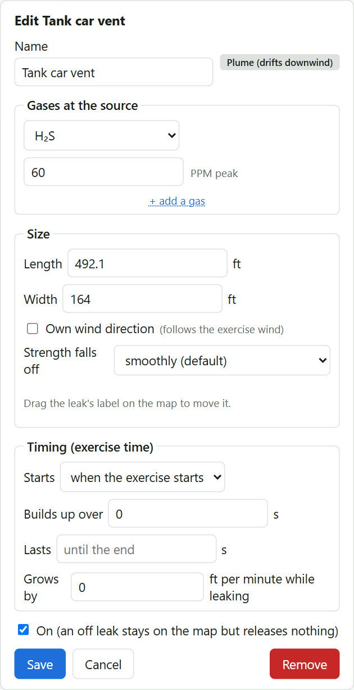</p>

*The whole leak form, for a plume: gases, size, fall-off and timing.*

### 7.5 Check the leaks before starting

Under **Show** on the map, pick a gas: the overlay shades where it reaches and how strongly,
coloured by the A1 and A2 levels (for O₂: where it's lowered or raised, and where it reaches an
alarm). Before the exercise starts, the overlay shows every leak at full strength (planning view);
while it runs, it shows the gas as it is now.

---

## 8. Run an exercise

### 8.1 Start, pause, end

The buttons at the top of the exercise page:

| Button | Effect |
|---|---|
| **Start** | Phones switch to the live meter ("EXERCISE ACTIVE") and leaks start on their timings. Exercise time starts counting. |
| **Pause** | Exercise time stops; leaks hold as they are ("EXERCISE PAUSED"). **Resume** carries on. |
| **End** | Every meter returns to clean air with its alarms, latches and exposure cleared ("EXERCISE ENDED"). The event log stays for the debrief. **Run again** starts a fresh run. |
| **Reset** | Back to **Draft**: closes the run and releases every override. |

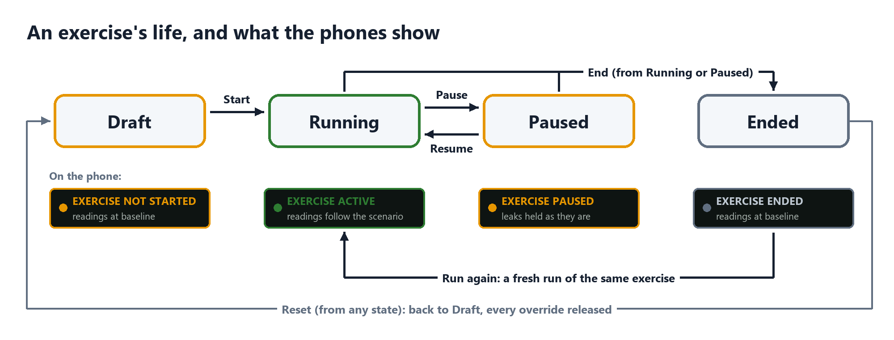
*An exercise's states, the buttons between them, and the header the phones show.*

### 8.2 The Live page

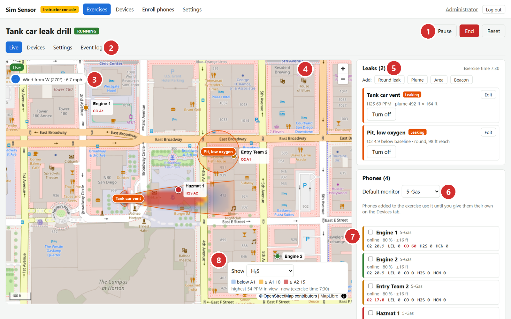
*The Live page of a running exercise.*

1. **Pause / End / Reset** (or **Start**, **Resume**, **Run again**, depending on the state).
2. The exercise's tabs: **Live**, **Devices**, **Settings**, **Event log**.
3. **The wind badge:** click it to change direction and speed during the drill.
4. **The map:** every phone with its name and current alarms (here Hazmat 1 in H₂S A2 inside the
   plume, Entry Team 2 in O₂ A1 in the pit), and the leaks. Drag a leak's label to move it.
5. **Leaks:** each with its status (for example "Starts with the exercise" or "Leaking"), **Edit**,
   **Turn off**, and **Start leak now** for leaks you trigger. **Add:** places a new one.
6. **Default monitor** for the exercise's phones.
7. **Phones:** each phone's monitor, connection, battery, GPS accuracy and its readings; tick
   phones to aim **Control readings** at them.
8. **Show:** the gas overlay ([§7.5](#75-check-the-leaks-before-starting)).

### 8.3 Control readings

**Control readings** overrides what phones read, whatever the leaks say:

1. **Phones:** **All in exercise**, a **Group**, or **Selected** (tick phones in the list).
2. The gas (or **All gases**) and what to do:

   | Mode | Effect |
   |---|---|
   | **Set to** | The reading moves to this value, with the sensor's response time. |
   | **Ramp to** | The reading moves to this value evenly over the given seconds. |
   | **Add** | Adds this amount on top of what the phone reads. |
   | **Sensor fault** | The sensor shows a fault. |

3. **Apply.** **Release <gas>** gives that gas back to the leaks; **Release everything** clears all
   overrides. **Silence alarms** silences the phones' alarm sound.
4. **Message to the phone screens** + **Send** shows a message on the phones (for example "Back out
   to the decon line"); the trainee dismisses it with **OK**.

<p align="center">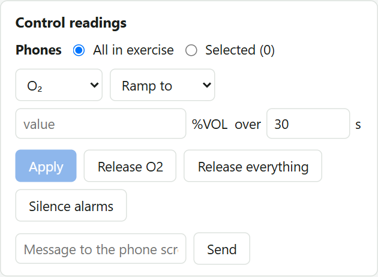</p>

*Control readings: here, about to ramp O₂ for every phone in the exercise over 30 s.*

---

## 9. The phone app, as the trainee sees it

<p align="center">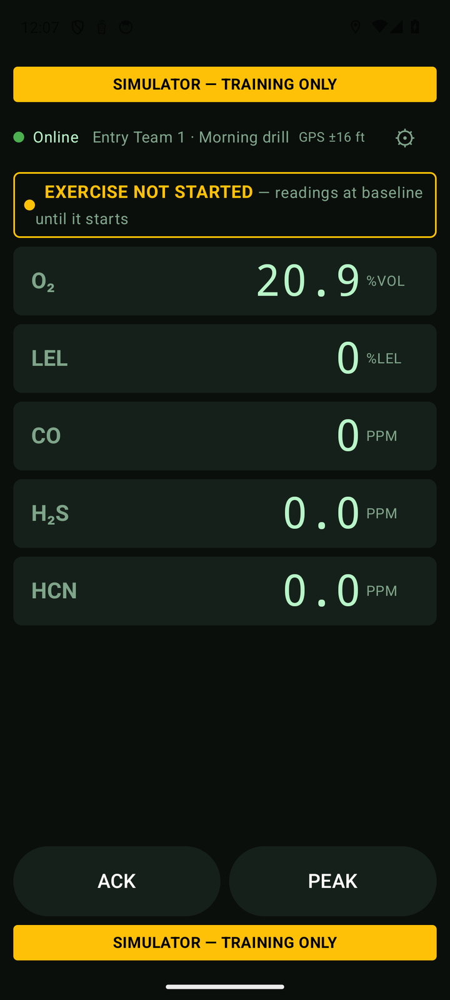 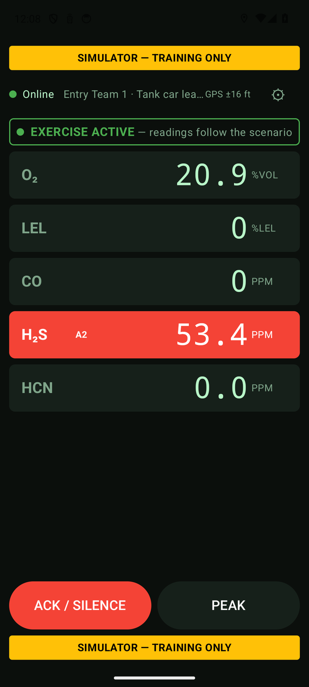 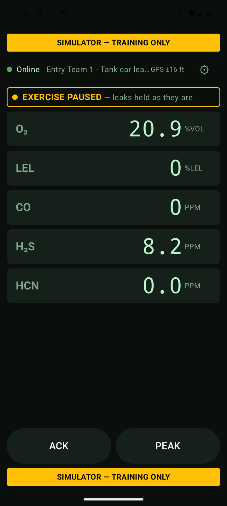</p>

*Before the start, running with H₂S in A2 alarm, and paused.*


- A yellow **SIMULATOR — TRAINING ONLY** banner is always on screen.
- A header above the meter says **EXERCISE NOT STARTED**, **ACTIVE**, **PAUSED** or **ENDED**.
- **Alarms:** A1 (low), A2 (high), STEL and TWA, with tone and vibration, also with the screen off.
  A reading above the sensor's range shows **OL**; a faulted sensor shows **FAULT**.
- **ACK / SILENCE** (or **OK**, depending on the screen style) acknowledges latching alarms and
  silences the tone; a new alarm always sounds again.
- **PEAK** shows the highest readings so far; tap again for live readings.
- **Settings** (the gear; behind the PIN if the MDM set one): the connection, exercise, monitor,
  GPS, beacons heard, **Calibrate** for each beacon, and **Shut down Sim Sensor**.
- **Back** on the meter offers **Shut down Sim Sensor?**: the meter, GPS, Bluetooth and connection
  stop until the app is opened again, and the instructor sees that the phone shut down.
- **App updates:** when the server offers a newer app, a card says so. **Update** opens the
  download; MDM-managed phones say the administrator installs updates. **Later** hides it.
- **Offline:** readings keep running through network drops and are sent when the phone reconnects.

<p align="center">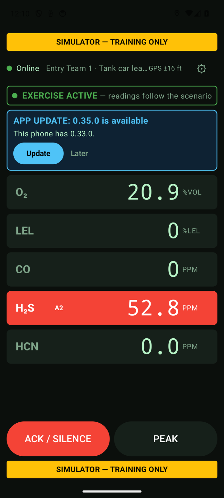 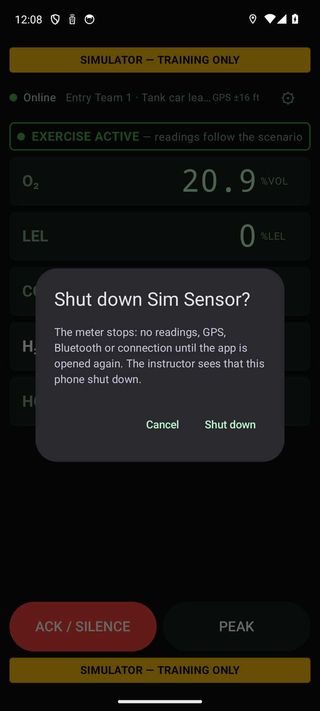</p>

*An app update offered by the server, and Back on the meter.*

---

## 10. Debrief: the event log

The exercise's **Event log** tab records everything, with times and who did it: phones connecting
and disconnecting, alarms raised and acknowledged, overrides, messages, leak and exercise changes,
calibrations. **Refresh** for the newest, **Load older** for earlier entries.

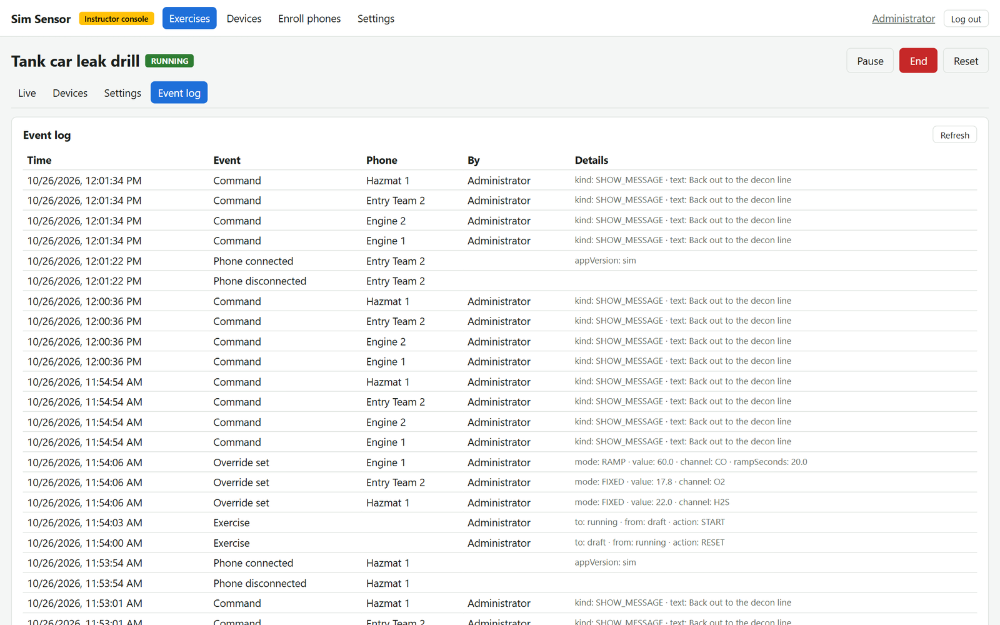
*The Event log of a drill.*

---

## 11. Manage the system

### 11.1 Update the server

**Settings → Server update** (admins) shows the running version, the newest on GitHub and what's
new. **Update to vX.Y.Z**:

1. backs up the database;
2. downloads and builds the new version (several minutes);
3. restarts the server (about a minute offline; phones reconnect by themselves);
4. goes back to the previous version by itself if the new one doesn't start.

The page shows each step and reloads itself when it's done. Phones are offered the matching app
afterwards.

### 11.2 Backups

**Settings → Server update → Backups** (admins):

- A backup is made **before every update**; **Make backup now** makes one at any time.
- **Restore…** puts the database back as it was then (type `restore` to confirm). Everything
  since is replaced, so the current data is backed up first, and the previous data is put back by
  itself if the restore fails. The server is offline for a minute or two.
- **Keep backups for** N days (default 7); the newest backup is always kept.

Backups live on the same machine (`/opt/simsensor/backups`). Copy the `.dump` files elsewhere from
time to time to protect against losing the server.

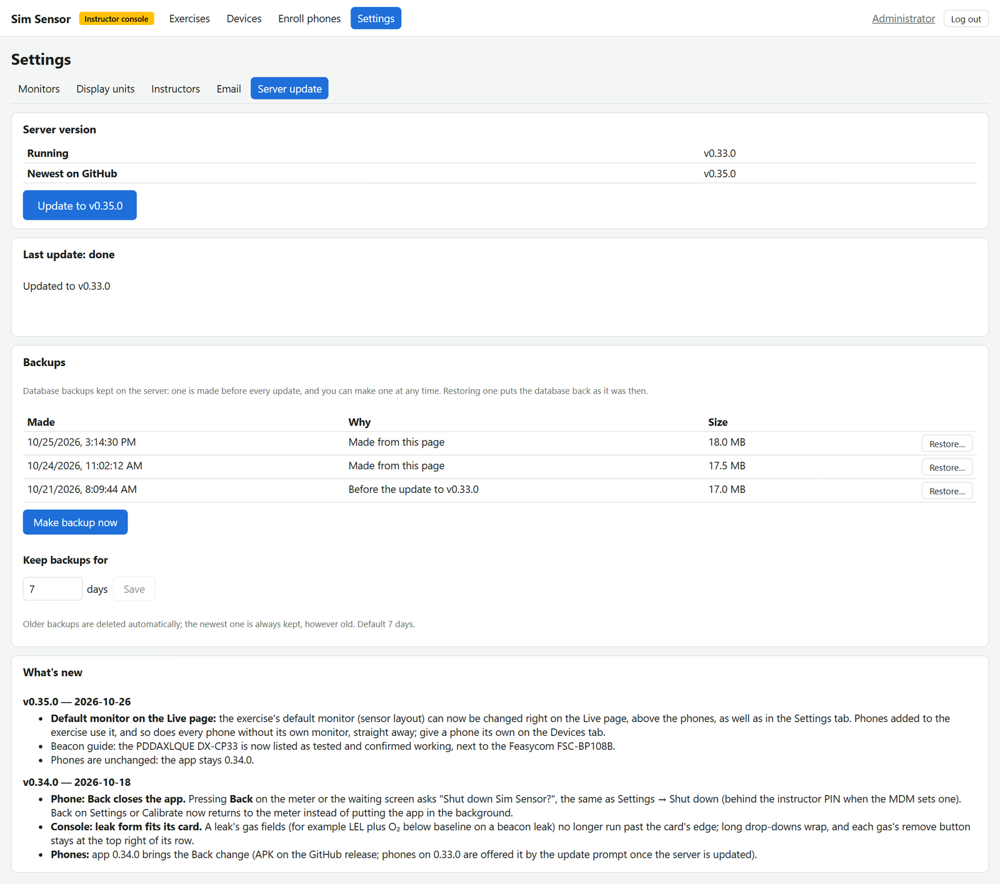
*Settings → Server update: versions, the last update, backups and what's new.*

### 11.3 Phones over time

- **Rename** a phone in **Devices → Phones**.
- **Revoke** a lost or retired phone; enroll it again to bring it back.
- **Rotate MDM tokens** with a retire date ([§4.3](#43-enroll-a-phone)).
- **App versions** are listed per phone; phones on an old app are offered the update.

### 11.4 Certificates and email

See [§2.3](#23-the-https-certificate) and [§3.2](#32-set-up-email-recommended). A certificate
warning on every page means renewal is failing: check that ports 80 and 443 are open and that the
DNS name still points at the server.

---

## 12. Troubleshooting

| Symptom | Check |
|---|---|
| Orange warning on every console page | The default admin account is still active ([§3.1](#31-replace-the-default-admin-account-do-this-first)), or the certificate is failing ([§2.3](#23-the-https-certificate)). |
| A phone shows "Offline" or "Connecting" | It needs outbound TCP 443 to the server; on guest or filtered Wi-Fi, WebSockets must be allowed. It reconnects by itself. |
| A phone shows the waiting screen | It isn't in an exercise: add it on the exercise's **Devices** tab. |
| Readings don't change near a map leak | The exercise must be running (or paused); the leak must be **On** and started; GPS must be good (the phone warns when it isn't). |
| A beacon leak reads nothing | The beacon must be in the exercise; the phone needs **Nearby devices** permission and Bluetooth; stay within the leak's reach and above the gas edge; calibrate on site ([§6.4](#64-calibrate-them-on-site)). |
| Readings read through a wall | Record a gas edge at the doorway; lower the transmit power or shield that side ([§6](#6-set-up-beacons)). |
| A trainee can't reset their password | Email isn't set up ([§3.2](#32-set-up-email-recommended)); an admin can **Reset password** instead. |
| "Updates aren't set up" on Server update | The server wasn't installed with the installer ([§2.2](#22-run-the-installer)). |

---

## 13. Glossary

| Term | Meaning |
|---|---|
| **A1 / A2** | Low and high alarm levels. For O₂, A1 is too little oxygen and A2 too much. |
| **Baseline** | A sensor's clean-air reading (O₂ 20.9 %, others 0). |
| **Beacon leak** | A leak centred on a Bluetooth beacon; the reading follows the phone's distance from it. |
| **Gas edge** | The beacon signal level recorded at a room's doorway; weaker signal reads nothing. |
| **Inert gas** | A gas that only takes the place of air (nitrogen, argon, helium); it lowers O₂. |
| **Latching** | An alarm that stays on until acknowledged, even after the reading clears. |
| **Monitor** | A meter model: sensors, ranges, alarm levels, response time and screen style. |
| **OL** | Over limit: the reading is above the sensor's range. |
| **Override** | An instructor's set, ramped, added or faulted reading for chosen phones. |
| **PID / VOC** | Photoionization detector, reading volatile organic compounds as isobutylene. |
| **Plume** | A leak that drifts downwind from its source. |
| **STEL / TWA** | Short-term (15 min) and time-weighted (8 h) exposure limits. |

For what changed in each version, see the [release notes](RELEASE_NOTES.md).
